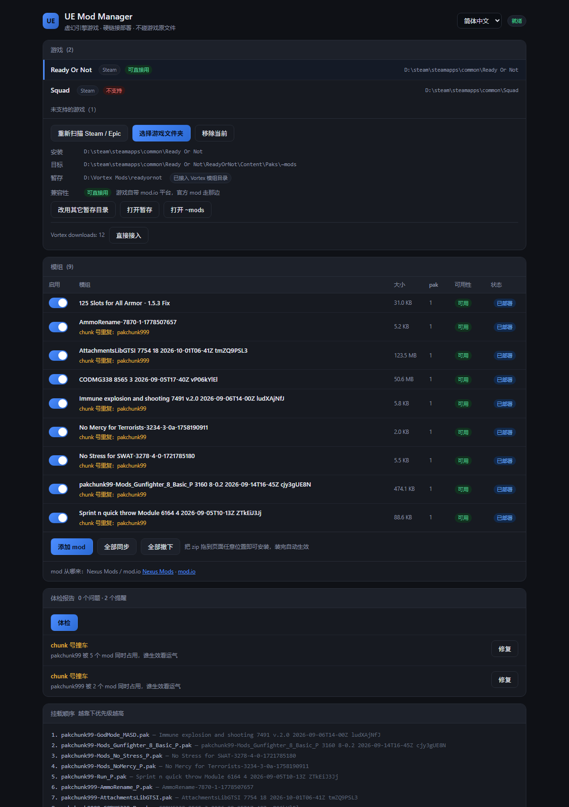

# UE Mod Manager

**我自己装 mod 时反复踩的几个坑，做成了一个小工具。**

只做虚幻引擎（UE4 / UE5）游戏的 pak mod：放进去、能开关、出问题能查。
免费、开源、无账号、不联网、不上传任何数据。9 MB 单文件，双击即用。

> **English** — A small tool for the pak-mod problems I kept running into with Unreal Engine games. Hardlink deployment (no admin rights, no UAC), pak validation, chunk-conflict detection with one-click fixes. **Not a replacement for Vortex** — it does one narrow job. Single 9 MB exe for Windows, no Python required. Everything runs on `127.0.0.1`; nothing is uploaded.



## 为什么会有这个

不是要替代谁。就是我自己的 mod 装不进去，一路查下来记的笔记，最后变成了代码。

同一个游戏（Ready or Not）、同一批 mod，我遇到的情况：

| 我看到的 | 后来查明白的 |
|---|---|
| 界面 9 个 mod 全打绿勾「已启用」 | 游戏目录里 **0 个新文件**，一个都没真的进去 |
| 点「部署」，进度停在 30% 排序中 | 日志 3 分钟不写一个字，不报错，UAC 也不弹 |
| 以为是自己权限不够 | 日志里是 `elevate.exe` 压根没启动，`EPERM` 被静默吞掉 |
| 想改成硬链接部署 | 界面只给一个选项，不给选，也不说为什么 |
| 让它自动更新 | 25 KB/s，下到 9% 归零重来 |

查到最后发现：它内部有 5 种部署方式，对这个游戏判定「硬链接不可用」，于是回退到「符号链接 + 每次现场提权」——而提权那一环从来没成功过，**且它不告诉你**。

这个工具就是把这些坑填上：**把 pak 放进 `~mods`，并且让你随时能拿掉。** 用硬链接，不需要任何权限，不弹 UAC，状态和文件永远一致。

## 和 Vortex 的关系

不是替代品，是补一刀的那种工具。

- **不抢它的活**：下载、装包、排序、更新这些它做得比我好，我不碰；这个工具只管"pak 到底进没进游戏、能不能一键拿掉"
- **可以共用同一份文件**：检测到它的暂存目录，点「直接接入」就把它当自己的库用，不搬文件、不重复下载
- **别同时部署**：两边都往 `~mods` 写会互相覆盖，用哪个就把另一个的部署撤掉
- **用着没问题就不需要这个**：它是给"装完没效果、又查不出为什么"那一种情况准备的

## 它不做什么

不下载 mod（用 Nexus / mod.io）、不联网、不管非虚幻引擎的游戏、不解析 pak 内部资源。

只做一件事，把它做对。

## 能做什么

- **拨一下开关** —— 立刻从游戏里移除 / 恢复，不存在"已启用但文件没进去"
- **硬链接部署** —— 不复制、不占双倍空间、不需要管理员权限、不弹 UAC
- **pak 校验** —— 读文件尾部魔数，判断这个包 UE 到底吃不吃，别装了个假的
- **体检 + 一键修复** —— 装完没效果时点一下，它告诉你是哪一步错了，并且能直接修
- **冲突检测** —— 同名 pak、重复 chunk 号，以及按引擎规则推算出来的挂载顺序（这个手工查不出来）
- **拖进来就装** —— zip 拖到窗口任意位置，自动解压、把 pak 提到正确层级、自动部署
- **6 种语言** —— 中文 / English / 日本語 / 한국어 / Русский / Español

## 体检：装完没效果时，先点这个

换游戏会自动跑一次，也可以手动点。它只查"能确定的事"，每条都带一个修复按钮：

| 检查项 | 说明 | 修复动作 |
|---|---|---|
| pak 藏在子目录 | UE 只认 mod 根层的 pak | 提到根层 |
| chunk 号重复 | 多个 mod 用同一个 `pakchunk99`（多数游戏无影响） | 换成空闲号（**只为避开重复索引，不改加载顺序**） |
| 不是 UE mod | Vortex 扩展、汉化包，放进去永远不生效 | 撤下 |
| pak 损坏 | 尾部连魔数都没有，游戏读不了 | 撤下 |
| 版本号不认识 | 读到 1–12 以外的版本，可能是新引擎的包 | 只提示，不动它 |
| 残留链接 | 暂存目录已删，游戏里还留着 | 清理 |
| 是复制不是链接 | 白占一份空间 | 重建硬链接 |

**所有修复都不碰源文件。** 改名只改部署出来的硬链接名，映射记在 `~/.uemm/renames.json`，同步时自动套用；想还原，删掉那个文件再点「全部同步」。

关于识别：**宁可说"不知道"，也不猜。** 版本号超出已知范围（1–12）的包不会被判成"损坏"，也不会给一键撤下 —— 它很可能只是比这个工具新的引擎打的包。

## 接着 Vortex 的资源用（不搬文件）

两个层次，都是零搬运：

1. **共用模组库**：检测到你用 Vortex 管理过这个游戏，就提示「直接接入」，点一下把它的暂存目录当自己的用，原来下的 mod 全部出现。
2. **扫它的下载目录**：Vortex 下载完的 zip 都堆在 `%APPDATA%\Vortex\downloads\<游戏>\`，界面会显示「Vortex downloads: N」，点一下把没装过的直接装进来。

## 多语言

简体中文 / English / 日本語 / 한국어 / Русский / Español。

默认按浏览器的 `Accept-Language` 选，右上角可以随时切换，选择记在本地。**所有文案都在 `uemm/i18n.py`**，加一门语言就是加一个字典，测试会检查各语言键是否对齐。

## 自动到什么程度

| 行为 | 时机 |
|---|---|
| 识别游戏 | **只在启动时扫一次**（Steam + Epic）。想找新装的游戏，点「重新扫描」，不会在后台反复读你的硬盘 |
| 推导安装路径 | 选游戏就完成：`~mods` 从游戏目录算，暂存目录自动放在同一块盘 |
| 接管已有 mod 库 | 检测到 Vortex 的暂存目录时，页面出现「直接接入」，点一下就读进来，不搬文件 |

## 支持等级：先看标，再动手

游戏列表里每个游戏都带一个等级，扫描后立刻可见，不用点进去才知道能不能用。

| 等级 | 含义 | 触发条件 |
|---|---|---|
| 可直接用 | pak 直投能生效 | 没有下面的任何阻碍 |
| 有条件 | 能装，但要满足额外条件 | 游戏用 IoStore（要 `.utoc/.ucas`），或带反作弊 |
| 不支持 | 装了也没用 | mod 是插件体系（`Plugins/Mods`），根本不看 `~mods` |

判断全部来自游戏目录里的真实文件，不是内置游戏名单 —— 所以新游戏、冷门游戏也能判。

## 支持的启动器

| 来源 | 识别方式 |
|---|---|
| Steam | `libraryfolders.vdf` → 所有库 → 扫 `steamapps/common` |
| Epic | 启动器清单 `ProgramData\Epic\EpicGamesLauncher\Data\Manifests\*.item` 里的 `InstallLocation`，读不到时退回常见安装目录 |
| 手动 | 「添加游戏目录」，指向含 `Engine` 的那一层 |

## 哪些游戏能用（先说清楚，省得下载了发现不支持）

判断标准只有三条，全中才算"完美可用"：

1. **虚幻引擎**（UE4 / UE5）
2. **直接读 `~mods` 里的 pak**（不需要额外 mod 加载器）
3. **没有反作弊拦着**

只中前两条的叫「有条件」，中了第三条反例的叫「不支持」。界面会自动给每个认出来的游戏打标，判断依据是游戏目录里的真实文件，不是内置名单。

### 能用的

| 游戏 | 说明 |
|---|---|
| Ready or Not | 本工具的主要验证对象 |
| Palworld / 幻兽帕鲁 | `Pal/Content/Paks/~mods` |
| STALKER 2 | `Stalker2/Content/Paks/~mods` |
| Hogwarts Legacy / 霍格沃茨之遗 | `Phoenix/Content/Paks/~mods` |
| Lies of P / 匹诺曹的谎言 | `LiesofP/Content/Paks/~mods` |
| Atomic Heart | `AtomicHeart/Content/Paks/~mods` |
| Borderlands 3 / 无主之地 3 | `Borderlands3/Content/Paks/~mods` |
| Star Wars Jedi: Fallen Order | `SwGame/Content/Paks/~mods` |
| FF7 Remake / 最终幻想 7 重制版 | `End/Content/Paks/~mods` |

UE5 游戏如果 Paks 里有 `.utoc`，mod 也必须带 `.utoc/.ucas`，界面会标「有条件」。

### 不能用的（常见误区）

| 游戏 | 引擎 | 为什么不行 |
|---|---|---|
| **Cyberpunk 2077 / 赛博朋克 2077** | REDengine 4 | 完全不同的生态：`archive/pc/mod/*.archive` + REDmod + RED4ext + CET，没有 pak，也没有 `~mods` |
| Baldur's Gate 3 | Divinity 4.0 | 用 `.pak` 但目录和格式都不同（`Data/`），不是 UE |
| Elden Ring / 装甲核心 | FromSoft 自研 | 不是 UE |
| CS2 / Dota 2 | Source 2 | 不是 UE |
| Squad | UE4 | mod 是引擎插件（`Plugins/Mods`），还有 EAC |
| Satisfactory | UE5 | 需要 SML 加载器，不是丢 pak |
| Fortnite / PUBG / Valorant | UE | 反作弊 + 纯在线，不允许 mod |

认出来但不支持的，界面会在游戏列表下面折叠一行「未支持的游戏（N）」，写明引擎 —— 这是为了让你知道**工具检查过了，是真的不行**，不是漏了。

### 为什么不能做成"通用 mod 管理器"

因为每个引擎把 mod 读进游戏的方式完全不同，没有共同点可以抽象：

| 引擎 | 加载机制 | 顺序由什么决定 |
|---|---|---|
| Unreal | 挂载 `~mods` 里的 pak | 文件名 / chunk 号 |
| Creation（上古卷轴、辐射） | 读 `Data/*.esp`，插件主文件定顺序 | `plugins.txt` 和 esp 头部的 master 列表 |
| REDengine（赛博朋克） | `archive/pc/mod` + REDmod 脚本 | `mods.json` 和加载器 |
| Unity | BepInEx 往进程注入 DLL | 插件目录 + 配置 |
| Source 2 | `addons/*.vpk` | addon 清单 |

想全支持，就得为每个引擎写一套部署器、一套冲突检测、一套排序规则 —— 这正是 Vortex 变成三万多个文件、MO2 变成十几万行 C++ 的原因。**这个项目选择只做第一行，把它做对。**

## 不是所有 UE 游戏都一样

这一点必须说清楚：**硬链接部署对所有游戏都一样，但游戏认不认这个 pak，差别很大。**

| 形态 | 表现 | 本工具 |
|---|---|---|
| 纯 pak 直投 | mod 就是一个 `.pak`，放进 `~mods` 就生效（Ready or Not 这类 UE4 单机） | 完全可用 |
| IoStore | 游戏带 `.utoc` / `.ucas`，mod 也必须带容器才加载（多数 UE5 游戏） | 标「注意」 |
| 插件式 mod | mod 是引擎插件，放在 `<项目>/Plugins/Mods`，根本不看 `~mods`（Squad 就是） | 标「不建议」 |
| 反作弊在线游戏 | 带 EAC / BattlEye，联机时拒绝加载未签名 pak（Squad） | 标「有条件」 |
| 官方 mod 平台 | 游戏内置 mod.io / 创意工坊，官方渠道安装（Ready or Not 也有 mod.io 目录） | 只提示，不干预 |
| 脚本 mod | 需要 UE4SS 注入 DLL，不是 pak 能解决的 | 检测到 UE4SS 会提示 |

选游戏后，路径区会显示一行**兼容性判断**，把命中的情况列出来。判断依据全是目录里的实际文件，不是游戏名单。

## mod 可用性判定

每个 mod 会被标成三种之一：

| 标记 | 含义 | 依据 |
|---|---|---|
| 可用 | UE 能直接加载 | `.pak` 尾部有合法的 `FPakInfo` 魔数，版本在 1–12 |
| 注意 | 能装，但可能不生效 | 游戏用 IoStore 但 mod 只有 `.pak`；或 pak 版本号不在已知范围（判断不了，只提示） |
| 无效 | 根本不是 UE mod | 没有 `.pak`，或尾部连魔数都没有 |

校验只读文件末尾 4 KB，所以哪怕 pak 有几十 GB 也是瞬间完成。

## 支持的形态

只要求游戏满足 UE 的标准目录结构：

```
<游戏根>/
├── Engine/                      ← UE 引擎目录（识别依据）
└── <项目名>/
    ├── Content/Paks/            ← 资源包
    │   └── ~mods/               ← mod 放这里
    └── Binaries/Win64/*.exe     ← 用于判断游戏是否在运行
```

在 **Ready or Not** 上完整验证过（含 9 个真 mod、5 个共用 `pakchunk99` 的冲突场景）。
**Squad** 被正确判成「不支持」——它的 mod 是引擎插件（`Plugins/Mods`），根本不看 `~mods`。

理论上覆盖所有标准打包的 UE4/UE5 游戏，但不同游戏的 mod 规范不同（有些要求特定前缀，有些走 mod.io），遇到不兼容的欢迎提 issue。

## 怎么打开

它是**本地工具 + 浏览器界面**，不是网站，不需要域名。

```
双击 UEMM.exe  →  后台起一个只监听 127.0.0.1 的服务  →  浏览器自动弹出界面
```

| 方式 | 命令 |
|---|---|
| 不想装任何东西 | Release 里下 `UEMM.exe`（9 MB 单文件），双击 |
| 有 Python 3.9+ | `python -m uemm --open`，零第三方依赖 |
| Windows 源码 | 双击 `run.bat` |

第一次运行 Windows 会拦一下（"未知发布者"）：点**更多信息 → 仍要运行**。没买代码签名证书的小工具都这样，不是报错。

### 装好之后，只留一个入口

界面里的「打开方式」有两个开关，点一下就行：

| 开关 | 效果 |
|---|---|
| **桌面图标** | 桌面生成一个 `UEMM 模组管理器.vbs`，双击就开浏览器界面，不弹黑窗口 |
| **开机自启** | 后台静默常驻，登录即启动；之后点书签也能直接打开 |

**关于书签**：把界面里显示的地址拖到书签栏，或按 `Ctrl+D` 就行。这一步没法自动做——浏览器退出时会用内存里的副本覆盖书签文件，Edge/Chrome 同步还会把它盖回来，所以只有你在浏览器里手动加一次才稳。

需要说明的是：**书签本身没法启动本地程序**。页面是由本机的服务提供的，服务没起来，书签只会打开一个空白页。所以顺序是：先双击一次 `UEMM.exe` 把入口装好（桌面图标 / 开机自启），之后才是"点书签 / 双击图标直接用"。

这是很常见的结构，qBittorrent、Jellyfin、Syncthing、Stable Diffusion WebUI 都是"本地服务 + 浏览器界面"，区别只是它们打包得更早。

## 用法

1. 顶部选游戏（启动时扫一次 Steam / Epic；装了新游戏点「重新扫描」，没认出来的点「选择游戏文件夹」）
2. 把 mod 的 zip **拖到窗口任意位置**，松手就装好并自动部署
3. 不想要了拨开关，立刻从游戏里移除

暂存目录默认在游戏同盘的 `UEMM/<项目名>/`，也可以直接指向 Vortex 的目录共用。**必须同盘**，硬链接的硬性要求。

## 原理

```
暂存  D:\UEMM\ReadyOrNot\MyMod\pakchunk99-MyMod_P.pak
          │  os.link()  硬链接：两个路径指向同一份数据
          ▼
游戏  D:\steam\...\ReadyOrNot\Content\Paks\~mods\MyMod\pakchunk99-MyMod_P.pak
```

- 不复制数据，不占额外空间
- 删链接不影响源文件，反之亦然
- 不需要管理员权限，不会弹 UAC

配置文件在 `~/.uemm/`（`config.json` 存游戏列表与路径，`state.json` 存哪些 mod 开着）。

## 关于加载顺序

UE 挂载 pak 的规则是固定的，而且**和 chunk 号无关**：

1. **优先级**：文件名以 `_P.pak` 结尾的补丁包 +100，`_2_P.pak` 这种 +300，普通包是 3。高优先级的一定覆盖低优先级的 —— 所以只要你的 mod 带 `_P`，它一定压过所有不带 `_P` 的。
2. **同优先级**：按**完整相对路径**的字母序挂载，越靠后挂载越晚，越能覆盖前面的。
3. **chunk 号（`pakchunk99` 里的那个 99）不参与排序**，它只是分块索引。

第 2 条有个容易踩的坑：本工具把每个 mod 放在 `~mods/<mod 名>/` 里，所以**跨 mod 比的是目录名，不是 pak 文件名**。把 `pakchunk99` 改成 `pakchunk100` 不会让 mod 更靠后 —— 字母序里 `100 < 99`，反而跑到前面去了。

想让某个 mod 赢，只有两种可靠办法：

- 给它加 `_P` 后缀（最干脆）
- 把它的目录名改成字母序更靠后的（比如 `zzz-` 开头）

下面「挂载顺序」面板按上面的规则推算，带 `_P` 的会标出来，最后一行就是覆盖同名资源的那个。

**这是推算，不是保证。** 不同游戏版本可能略有差异，真出问题时以游戏日志（`-fileopenlog`）为准。工具不会为了让某个 mod 排在后面去改你的文件名。

## 已知限制

- 只处理 `.pak` / `.utoc` / `.ucas` / `.sig`，不解析 pak 内部资源，因此**不会检测"两个 mod 改了同一个贴图"这种资源级冲突**
- 和 Vortex 共用暂存目录时，**不要同时让两边都执行部署**，否则会互相覆盖 `~mods` 里的内容
- `.7z` / `.rar` 不支持（需要先解压成 zip）
- 不提供下载功能，mod 自己去 Nexus / mod.io / Discord 取
- 不处理 FOMOD、脚本扩展器、`.ini` 合并

## 它往游戏目录写了什么

只有两样，都可以一眼看完：

```
<项目>/Content/Paks/~mods/
├── <mod 名>/          ← 硬链接指向暂存目录里的真实文件
└── .uemm.json         ← 本工具的清单（记录了谁放了哪些文件，用于「全部撤下」）
```

不修改任何原始 `.pak`，不覆盖 `.exe`，不写注册表。

## 自己打包 exe

```bash
pip install pyinstaller
python -m PyInstaller --onefile --noconsole --name UEMM ^
  --icon docs/icon.ico launcher.py
```

Windows 上直接双击 `build.bat` 也行。产物在 `dist\UEMM.exe`，约 9 MB，单文件，不需要目标机器装 Python。

## 测试

```bash
python -m unittest discover -s tests -v
```

70 个用例，全部在临时目录里跑（自带假游戏、假 pak、假 Epic 清单），**不碰你真实的游戏目录**。覆盖：游戏识别、支持等级、Vortex 目录误判、pak 校验、硬链接部署、开关失败回滚、残留清理、zip 路径穿越、同名 pak、chunk 重编号、配置读写，以及本地接口的 Host / Origin / Content-Type 三道闸。

## 开发

```
uemm/
├── detect.py      Steam / Epic 库解析、UE 识别、兼容性判断、Vortex 探测
├── mods/          mod 子系统，一层一件事
│   ├── paks.py      pak 格式：校验、判定、chunk 号
│   ├── deploy.py    目录与硬链接：暂存目录、部署、清单
│   ├── install.py   压缩包落盘：zip / 单个 pak → 暂存目录
│   └── procs.py     游戏是否在运行
├── doctor.py      体检 + 一键修复
├── store.py       配置与状态（~/.uemm）
├── server.py      HTTP 接口（含来源校验）
├── web.py         单页界面
├── i18n.py        6 种语言的文案
├── entry.py       桌面图标 / 开机自启
├── dialogs.py     系统文件夹选择框
└── tests/         隔离环境的单元测试
```

`mods/__init__.py` 是对外唯一出口，`server` 和 `doctor` 只从那里取函数，不直接摸子模块。

界面（HTML/CSS/JS）故意内联在 `web.py` 里，不拆成静态文件 —— 这样 PyInstaller 打单文件时不需要额外的 `--add-data`，少一个打包失败的理由。

`detect.py` 保持单文件：它是一组"看这台机器上有什么"的判断，拆开反而要来回传路径。

调试扫描：

```bash
python -m uemm --scan
```

## License

MIT
